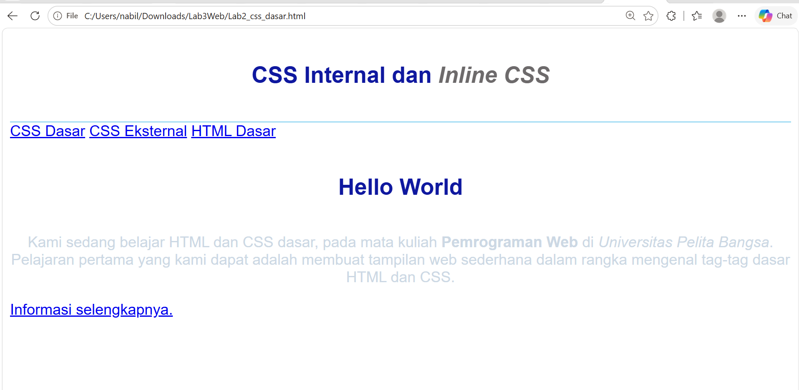
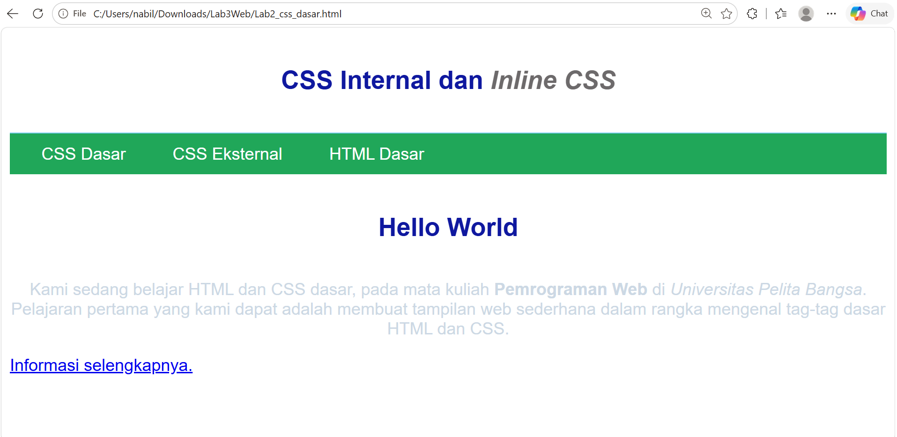
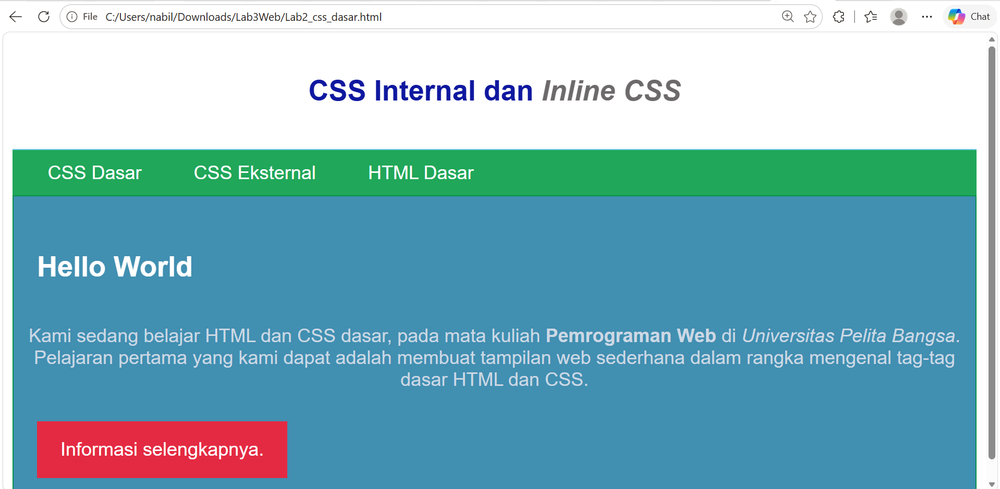

# Laporan Praktikum 3: CSS Dasar

Repositori ini dibuat untuk memenuhi tugas praktikum mata kuliah **Pemrograman Web** di **Universitas Pelita Bangsa**. Modul ini membahas mengenai dasar-dasar *Cascading Style Sheets (CSS)*, aturan penulisan, serta penggunaan selector.

---

## 👨‍💻 Identitas Mahasiswa
* **Nama:** Nabila Lutfia Sari
* **NIM:** *312510040*
* **Kelas / Program Studi:** Teknik Informatika - Universitas Pelita Bangsa

---

## 📋 Tujuan Praktikum
1. Mahasiswa mampu memahami konsep dasar CSS.
2. Mahasiswa mampu memahami aturan penulisan pada CSS (Internal, Eksternal, dan Inline).
3. Mahasiswa mampu memahami selector sebagai pengontrol CSS (Element, ID, dan Class Selector).
4. Mahasiswa mampu membuat pengaturan dan styling CSS pada dokumen HTML.

---

## Langkah-Langkah Praktikum dan Hasil Screenshot

### 1. Membuat Dokumen HTML (`lab2_css_dasar.html`)
Membuat struktur dasar dokumen HTML yang mencakup tag `header`, `nav`, dan `div` dengan ID tertentu.
* **Hasil Tampilan:**
  

### 2. Menambahkan CSS Internal
Menambahkan tag `<style>` di dalam bagian `<head>` dokumen HTML untuk mengatur gaya elemen dasar seperti *font-family*, *header*, dan tag `h1`.
* **Hasil Tampilan:**
  

### 3. Menambahkan Inline CSS
Menambahkan atribut `style` secara langsung pada tag paragraf `<p>` untuk mengatur perataan teks dan warna font.
* **Hasil Tampilan:**
  

### 4. Membuat CSS Eksternal (`style_eksternal.css`)
Membuat file CSS terpisah untuk mengatur tampilan menu navigasi (`nav`), warna latar belakang hijau, serta efek *hover*.
* **Hasil Tampilan:**
  

### 5. Menambahkan CSS Selector (ID & Class Selector)
Menggunakan **ID Selector (`#intro`)** untuk kotak pengantar dan **Class Selector (`.button`, `.btn-primary`)** untuk tombol interaktif.
* **Hasil Tampilan:**
  

---

## 📂 Struktur File Repositori
```text
Lab3Web/
│
├── lab2_css_dasar.html       # File utama dokumen HTML
├── style_eksternal.css       # File stylesheet terpisah
├── langkah1.png              # Screenshot langkah 1
├── langkah2.png              # Screenshot langkah 2
├── langkah3.png              # Screenshot langkah 3
├── langkah4.png              # Screenshot langkah 4
├── langkah5.png              # Screenshot langkah 5
└── README.md                 # Laporan praktikum
